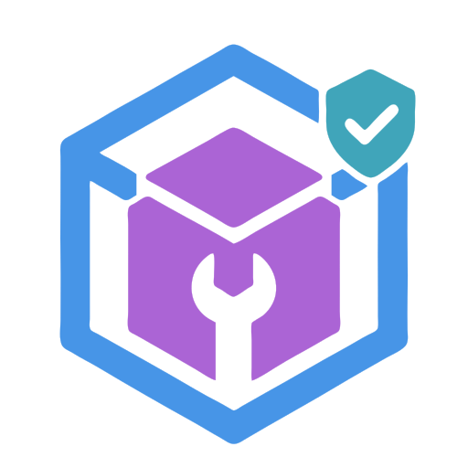
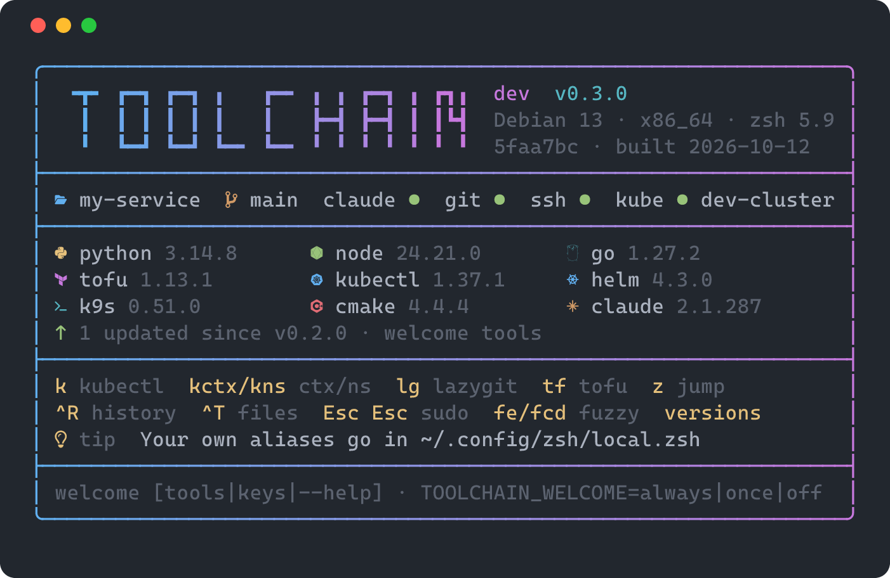
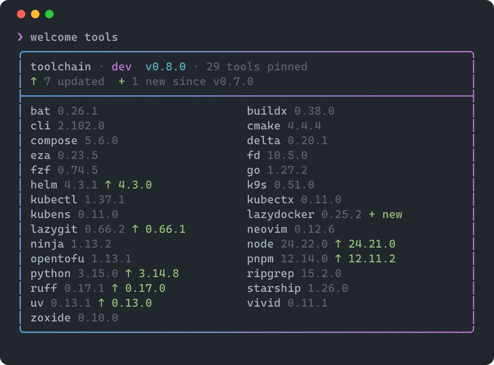
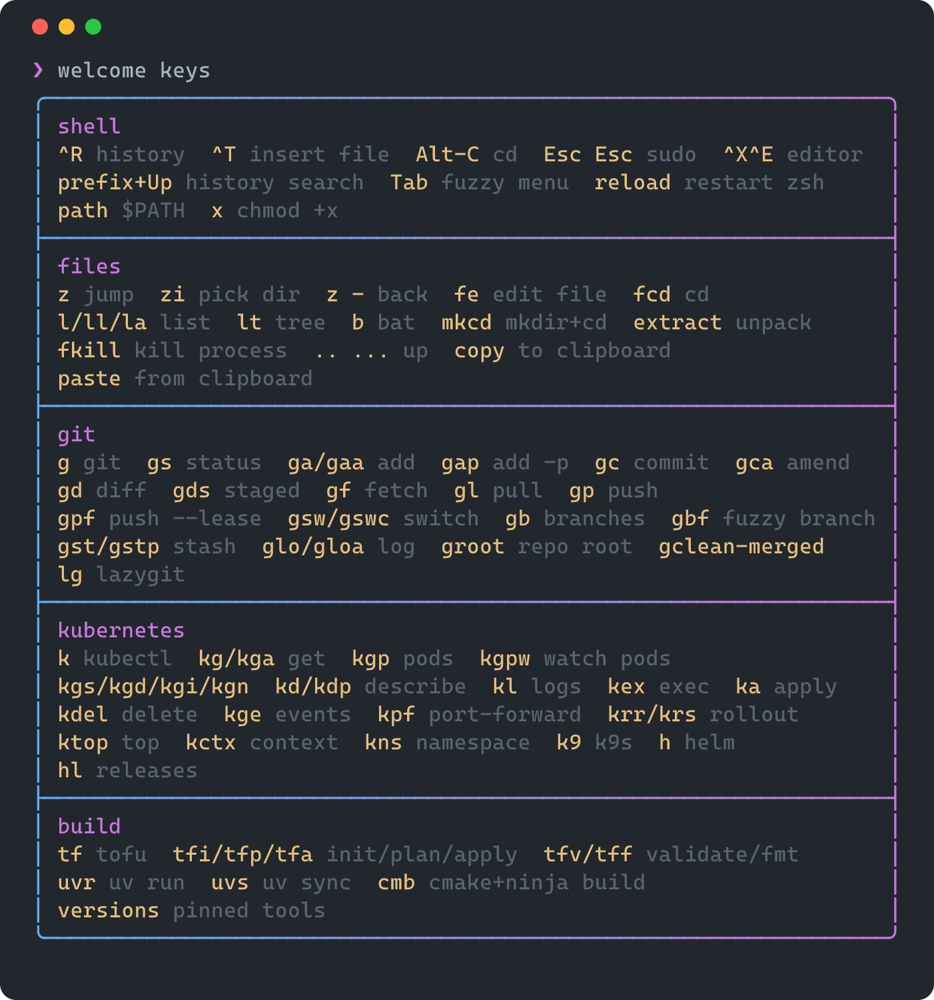

<h1 align="center">
  <br>
  toolchain-image
</h1>

One versioned toolchain, two images: **`ci`** for pipelines and **`dev`** for
[Dev Containers](https://containers.dev). Both come from a single Dockerfile and a single pinned
tool manifest, so "it works in my dev container" means "it works in CI".

- **`dev` is built `FROM ci`.** Every CI tool is byte-for-byte the same file in the dev container;
  `dev` only adds conveniences. A parity test enforces it.
- **Everything is pinned:** the base image by digest, every tool by exact version, each verified
  by checksum, maintainer signature or git commit.
  [Renovate](https://docs.renovatebot.com) proposes updates as pull requests.
- **Releases are verifiable:** SBOM and build provenance attached, keyless signatures, a
  vulnerability gate, and promotion by digest (the released bytes are the tested bytes).
  A weekly rebuild picks up OS security fixes.

## What's inside

| Image | Contents                                                                                                                                                                                                                                                                                                                                                                                                                   |
| ----- | -------------------------------------------------------------------------------------------------------------------------------------------------------------------------------------------------------------------------------------------------------------------------------------------------------------------------------------------------------------------------------------------------------------------------- |
| `ci`  | Debian 13 (trixie) slim · OpenTofu · kubectl · Helm · Python + uv + Ruff · Go · Node.js · CMake + Ninja · GCC/Clang toolchain                                                                                                                                                                                                                                                                                              |
| `dev` | Everything in `ci`, plus: zsh with a modular config and a welcome screen · starship · fzf, zoxide, eza, bat, fd, ripgrep · Docker CLI with buildx and compose (host engine or Docker-in-Docker) · delta, lazygit, lazydocker, GitHub CLI · pnpm · kubectx/kubens, k9s · Neovim · clangd, lldb, gdb · the Claude Code VS Code extension with a secure default policy · VS Code extensions and settings for all of the above |

Exact versions are in [`toolchain/mise.toml`](toolchain/mise.toml) and
[`toolchain/dev/mise.toml`](toolchain/dev/mise.toml) (with the shell's own tools in
[`toolchain/shell/mise.toml`](toolchain/shell/mise.toml)), and in every release's notes.
The `dev` image is opinionated but fully overridable: see [Customizing](docs/customizing.md).

### Image contract

- `ci`: root as the default user, no `ENTRYPOINT` or `WORKDIR`, glibc, with `bash`, `grep`,
  `sudo`, `which` and `groupadd`. These are the requirements of GitHub Actions and Azure DevOps
  container jobs.
- `dev`: a single regular user `vscode` (UID 1000) with passwordless sudo and zsh as its login
  shell.

## Use it

Images are published as `ghcr.io/<owner>/toolchain/{ci,dev}`. Release tags `X.Y.Z` are
immutable by convention; `X.Y` and `X` float. **Pin the digest** shown in the release notes and
let Renovate or Dependabot bump it.

### In CI

```yaml
# GitHub Actions
jobs:
  build:
    runs-on: ubuntu-latest
    container: ghcr.io/<owner>/toolchain/ci:<version>@sha256:<digest>
    defaults: { run: { shell: bash } }
    steps:
      - uses: actions/checkout@<sha>
      - run: make test
```

```yaml
# GitLab CI
build:
  image: { name: "ghcr.io/<owner>/toolchain/ci:<version>@sha256:<digest>", entrypoint: [""] }
  script: [make test]
```

```yaml
# Azure DevOps
resources:
  containers:
    - container: toolchain
      image: ghcr.io/<owner>/toolchain/ci:<version>@sha256:<digest>
jobs:
  - job: build
    pool: { vmImage: ubuntu-latest }
    container: toolchain
    steps: [{ script: make test }]
```

```groovy
// Jenkins (Kubernetes plugin)
podTemplate(containers: [
  containerTemplate(name: 'ci', image: 'ghcr.io/<owner>/toolchain/ci:<version>@sha256:<digest>',
                    command: 'sleep', args: 'infinity')
]) { node(POD_LABEL) { container('ci') { sh 'make test' } } }
```

### As a dev container

Copy [`devcontainer/devcontainer.json`](devcontainer/devcontainer.json) to `.devcontainer/` in
your repository and fill in the image reference. Editor extensions, settings, the `vscode` user
and the shell all come from the image, so the file stays short. Anything you set there overrides
the image.

The first terminal in a new container shows a short greeting:

- the image version and build;
- your repository and branch;
- what's set up (Claude Code sign-in, git identity, SSH agent, kube context);
- the main tool versions, marked `↑` when updated since the previous release;
- common shortcuts and a tip of the day.



Run `welcome` to see it again. `welcome tools` lists every pinned tool and what changed, and
`welcome keys` lists every alias and key binding. `TOOLCHAIN_WELCOME` (`once`, `always`, `off`) sets
when it appears: see [Customizing](docs/customizing.md#shell-zsh).

<details>
<summary>welcome tools and welcome keys</summary>





</details>

### Verify an image

```sh
cosign verify ghcr.io/<owner>/toolchain/dev@sha256:<digest> \
  --certificate-identity 'https://github.com/<owner>/<repo>/.github/workflows/release.yml@refs/tags/v<version>' \
  --certificate-oidc-issuer https://token.actions.githubusercontent.com
```

Each release's notes contain the exact command, the toolchain list, the changes and the
vulnerability report. The identity above is for releases cut from a tag. Weekly and manual
releases are signed by the workflow on `main`, so their identity ends in
`release.yml@refs/heads/main`.

## Running your own copy

1. Fork the repository. The workflows publish to `ghcr.io/<your-owner>/toolchain/...` with no
   changes needed.
2. Repository settings: allow **squash merging** only, with the **PR title** as the commit title
   (linted as Conventional Commits) and the branch's **commit messages** as the body (keeps PR
   descriptions, such as Renovate's update tables, out of `main`'s history).
3. Install the [Renovate](https://github.com/apps/renovate) GitHub App in a mode that opens pull
   requests. Updates arrive weekly in UTC; set `timezone` in `renovate.json` if you want a local
   schedule.
4. Push a `v0.1.0` tag to cut the first release. After that, releases happen on every `vX.Y.Z`
   tag, on demand (`workflow_dispatch` on `main`), and weekly. Weekly and on-demand releases
   take the next version from the commits since the last tag: a `feat` bumps minor, a breaking
   change bumps major (minor below 1.0.0), and anything else bumps patch, including a rebuild
   with no changes.
5. If your images are private, consumers need `docker login ghcr.io` with a token that has
   `read:packages`.

Tools, theme, Claude Code policy and base image are all yours to change. See
[Customizing](docs/customizing.md#your-own-image-family).

## Develop

Requires Docker with Buildx, GNU Make and [mise](https://mise.jdx.dev). `mise install` provides
every lint, test and release tool at the pinned versions from [`mise.toml`](mise.toml).

| Command                                      | What it does                                                                                           |
| -------------------------------------------- | ------------------------------------------------------------------------------------------------------ |
| `make build`                                 | Build `ci` and `dev` as `toolchain/{ci,dev}:local`                                                     |
| `make test`                                  | Structure, smoke, parity, prompt, k9s config, Docker socket and logging tests against the local images |
| `make lint` / `make fmt`                     | Check / apply formatting and lint on every file (`.editorconfig` is the policy)                        |
| `make spell`                                 | Spell-check the repository                                                                             |
| `make scan`                                  | Vulnerability gate and report (Trivy) for the local images                                             |
| `make shell` / `make shell-live`             | Interactive shell in the dev image; `-live` mounts `config/` so edits apply instantly                  |
| `make lock`                                  | Regenerate the toolchain lock files after editing a manifest                                           |
| `make check-commits` / `make check-pr-title` | Lint commit messages / a PR title (commitlint)                                                         |
| `make changelog`                             | Write `CHANGELOG.md` from the commit history (git-cliff)                                               |
| `make screenshots`                           | Re-render the README's `welcome` screenshots (`FONT=<Nerd Font Mono .ttf>`)                            |

To add a tool: edit `toolchain/mise.toml` (or `toolchain/dev/mise.toml` for dev-only tools, or
`toolchain/shell/mise.toml` for tools the shell config uses), run
`make lock`, add a version probe to `tests/smoke.sh` (the test fails without one), then
`make build test`.

## Versioning and releases

Semantic versioning describes the **image contract**:

- **Major:** a tool is removed, or a breaking upgrade (e.g. a major version of a language).
- **Minor:** a tool is added, or a minor upgrade.
- **Patch:** a weekly rebuild or a patch upgrade.

Commit types map onto these: `fix` → patch, `feat` → minor, and `!` / `BREAKING CHANGE` → major.

Every release passes the full test suite against the exact pushed digests, then a vulnerability
gate, before it's promoted:

- **Blocks the release:** a fixable CRITICAL anywhere, or a fixable HIGH/CRITICAL in OS packages.
- **Reported only:** fixable HIGH findings inside upstream prebuilt binaries are listed in the
  release notes. Version bumps fix those.

## Contributing

- **Commits and PR titles** follow [Conventional Commits 1.0.0](https://www.conventionalcommits.org/en/v1.0.0/).
  PRs are squash-merged, so the PR title becomes the commit on `main`.
- **Formatting:** spaces only (the Makefile included), 120 columns, LF line endings. Markdown is
  formatted by Prettier (tables aligned, code samples untouched) and checked by markdownlint. Run
  `make fmt`.
- **Before you push:** `make lint test`. CI runs the same targets.

## Security notes

- The `dev` image's Claude Code policy (deny reading credentials and `.env` files, no
  bypass-permissions mode) is a default, not a boundary: `vscode` has sudo. See
  [Customizing → Claude Code](docs/customizing.md#claude-code) for enforced setups.
- Releases are signed with keyless Sigstore signatures. Signatures are recorded in the **public** Rekor
  transparency log, which reveals the repository name and image digests even for private
  repositories.
- Downloads at build time are checksum- or signature-verified. Build secrets are passed as
  BuildKit secrets, never as build arguments.

## License

[Apache License 2.0](LICENSE). Vendored third-party files keep their own notices (for example
the k9s skin, also Apache-2.0).

## Documentation

- [Customizing](docs/customizing.md): every layer you can override
- [Lifecycle](docs/lifecycle.md): what goes in `postCreate`/`postStart`/`postAttach`, the lifecycle
  and validation libraries, and `dev-status`, `dev-wait` and `dev-reset`
- [Design records](docs/design/README.md): the research behind the project, and where the
  implementation differs from it
